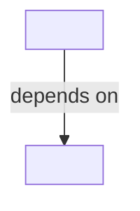

# Specification index

This index summarizes the repository's specifications and their relationships.
Each specification's `Depends on` metadata is authoritative; this file is a
derived navigation aid.

## Specifications

| Specification | Status | Priority | Purpose | Depends on | Related ADRs |
| --- | --- | --- | --- | --- | --- |
| [<Specification>](./<spec-name>.md) | Draft | Medium | <Brief purpose> | None | None |

For each related ADR, include a short description of the decision it records.
Link to the ADR for its context, alternatives, rationale, and consequences.

## Dependency graph

Include independent specifications and shared dependencies. If a dependency
cycle is discovered, record it under unresolved issues instead of representing
it as a valid delivery order.

## Unresolved issues

- None.
