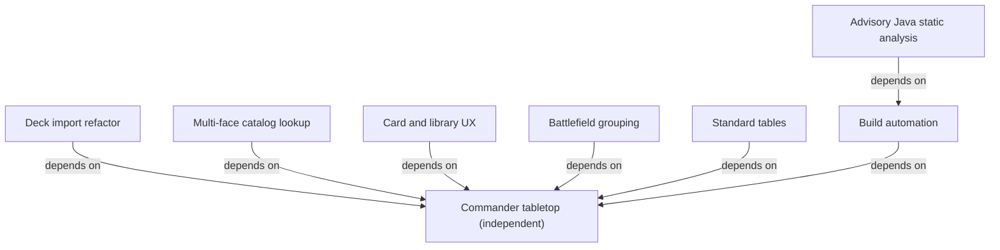

# Specification index

Each specification's `Depends on` metadata is authoritative.

| Specification | Status | Priority | Purpose | Depends on | Related ADRs |
| --- | --- | --- | --- | --- | --- |
| [Commander tabletop](commander-tabletop.md) | Completed | High | Four-player assisted Commander | None | [ADR-0001](../docs/adr/0001-authoritative-game-state.md): authoritative state, recovery, and privacy |
| [Build automation](build-automation.md) | Completed | Medium | Frontend-first clean packaging and artifact reporting | [Commander tabletop](commander-tabletop.md) | None |
| [Advisory Java static analysis](java-static-analysis.md) | Completed | Medium | Broad nonblocking PMD analysis and complete findings logs | [Build automation](build-automation.md) | [ADR-0003](../docs/adr/0003-advisory-java-static-analysis.md): advisory Maven analysis and native reports |
| [Deck import refactor](deck-import-refactor.md) | Completed | Medium | Source-specific parsing and strict provider validation | [Commander tabletop](commander-tabletop.md) | [ADR-0001](../docs/adr/0001-authoritative-game-state.md): existing authoritative state boundary |
| [Multi-face catalog lookup](catalog-multiface-lookup.md) | Completed | High | Resolve full multi-face card names through Scryfall identifiers | [Commander tabletop](commander-tabletop.md) | [ADR-0001](../docs/adr/0001-authoritative-game-state.md): existing authoritative state boundary |
| [Card and library UX](tabletop-card-and-library-ux.md) | Completed | Medium | Standard tap orientation and private library name filtering | [Commander tabletop](commander-tabletop.md) | [ADR-0001](../docs/adr/0001-authoritative-game-state.md): existing privacy boundary |
| [Battlefield grouping](battlefield-grouping.md) | Completed | Medium | Automatic permanent type groups with lands below | [Commander tabletop](commander-tabletop.md) | [ADR-0001](../docs/adr/0001-authoritative-game-state.md): existing state and privacy boundary |
| [Standard tables](standard-tables.md) | Completed | High | Two-player Standard with format-aware validation | [Commander tabletop](commander-tabletop.md) | [ADR-0002](../docs/adr/0002-room-format-profiles.md): immutable format profiles and legacy defaults; [ADR-0001](../docs/adr/0001-authoritative-game-state.md): authority and privacy |

## Dependency graph

## Unresolved issues

None.
