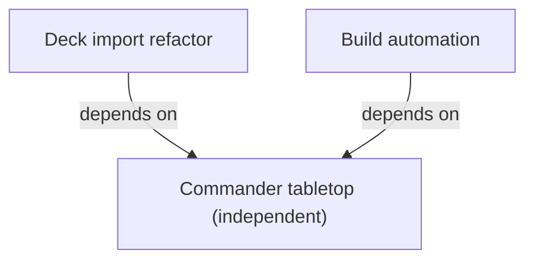

# Specification index

Each specification's `Depends on` metadata is authoritative.

| Specification | Status | Priority | Purpose | Depends on | Related ADRs |
| --- | --- | --- | --- | --- | --- |
| [Commander tabletop](commander-tabletop.md) | Completed | High | Four-player assisted Commander | None | [ADR-0001](../docs/adr/0001-authoritative-game-state.md): authoritative state, recovery, and privacy |
| [Build automation](build-automation.md) | Completed | Medium | Frontend-first clean packaging and artifact reporting | [Commander tabletop](commander-tabletop.md) | None |
| [Deck import refactor](deck-import-refactor.md) | Completed | Medium | Source-specific parsing and strict provider validation | [Commander tabletop](commander-tabletop.md) | [ADR-0001](../docs/adr/0001-authoritative-game-state.md): existing authoritative state boundary |

## Dependency graph

## Unresolved issues

None.
