# Specification index

Each specification's `Depends on` metadata is authoritative.

| Specification                                                     | Status    | Priority | Purpose                                                                     | Depends on                                                                                                                                       | Related ADRs                                                                                                                                                                                                                                                      |
| ----------------------------------------------------------------- | --------- | -------- | --------------------------------------------------------------------------- | ------------------------------------------------------------------------------------------------------------------------------------------------ | ----------------------------------------------------------------------------------------------------------------------------------------------------------------------------------------------------------------------------------------------------------------- |
| [Commander tabletop](commander-tabletop.md)                       | Completed | High     | Four-player assisted Commander                                              | None                                                                                                                                             | [ADR-0001](../docs/adr/0001-authoritative-game-state.md): authoritative state, recovery, and privacy                                                                                                                                                              |
| [Build automation](build-automation.md)                           | Completed | Medium   | Frontend-first clean packaging and artifact reporting                       | [Commander tabletop](commander-tabletop.md)                                                                                                      | [ADR-0003](../docs/adr/0003-advisory-java-static-analysis.md): existing advisory build integration                                                                                                                                                                |
| [Advisory Java static analysis](java-static-analysis.md)          | Completed | Medium   | Broad nonblocking PMD analysis and complete findings logs                   | [Build automation](build-automation.md)                                                                                                          | [ADR-0003](../docs/adr/0003-advisory-java-static-analysis.md): advisory Maven analysis and native reports                                                                                                                                                         |
| [Deck import refactor](deck-import-refactor.md)                   | Completed | Medium   | Source-specific parsing and strict provider validation                      | [Commander tabletop](commander-tabletop.md)                                                                                                      | [ADR-0001](../docs/adr/0001-authoritative-game-state.md): existing authoritative state boundary                                                                                                                                                                   |
| [Multi-face catalog lookup](catalog-multiface-lookup.md)          | Completed | High     | Resolve full multi-face card names through Scryfall identifiers             | [Commander tabletop](commander-tabletop.md)                                                                                                      | [ADR-0001](../docs/adr/0001-authoritative-game-state.md): existing authoritative state boundary                                                                                                                                                                   |
| [Card and library UX](tabletop-card-and-library-ux.md)            | Completed | Medium   | Standard tap orientation and private library name filtering                 | [Commander tabletop](commander-tabletop.md)                                                                                                      | [ADR-0001](../docs/adr/0001-authoritative-game-state.md): existing privacy boundary                                                                                                                                                                               |
| [Battlefield grouping](battlefield-grouping.md)                   | Completed | Medium   | Automatic permanent type groups with lands below                            | [Commander tabletop](commander-tabletop.md)                                                                                                      | [ADR-0001](../docs/adr/0001-authoritative-game-state.md): existing state and privacy boundary                                                                                                                                                                     |
| [Standard tables](standard-tables.md)                             | Completed | High     | Two-player Standard with format-aware validation                            | [Commander tabletop](commander-tabletop.md)                                                                                                      | [ADR-0002](../docs/adr/0002-room-format-profiles.md): immutable format profiles and legacy defaults; [ADR-0001](../docs/adr/0001-authoritative-game-state.md): authority and privacy                                                                              |
| [Service failure diagnostics](service-failure-diagnostics.md)     | Completed | Medium   | Typed service failures, preserved causes, and boundary/recovery diagnostics | [Deck import refactor](deck-import-refactor.md), [Multi-face catalog lookup](catalog-multiface-lookup.md), [Standard tables](standard-tables.md) | [ADR-0001](../docs/adr/0001-authoritative-game-state.md): existing privacy and recovery boundaries                                                                                                                                                                |
| [Catalog decomposition](catalog-decomposition.md)                 | Completed | Medium   | Separate catalog coordination, cache persistence, and Scryfall adaptation   | [Service failure diagnostics](service-failure-diagnostics.md)                                                                                    | [ADR-0004](../docs/adr/0004-catalog-component-boundaries.md): catalog component responsibilities; [ADR-0001](../docs/adr/0001-authoritative-game-state.md): existing state/privacy boundary                                                                       |
| [Game-engine decomposition](game-engine-decomposition.md)         | Completed | Medium   | Separate command coordination, access, views, and zone transitions          | [Standard tables](standard-tables.md)                                                                                                            | [ADR-0005](../docs/adr/0005-game-engine-component-boundaries.md): engine responsibilities and functional dispatch; [ADR-0001](../docs/adr/0001-authoritative-game-state.md): state/privacy; [ADR-0002](../docs/adr/0002-room-format-profiles.md): format profiles |
| [Security filter refactor](security-filter-refactor.md)           | Completed | Medium   | Preserve security behavior while simplifying filter policy                  | [Commander tabletop](commander-tabletop.md)                                                                                                      | [ADR-0001](../docs/adr/0001-authoritative-game-state.md): existing security/privacy boundary                                                                                                                                                                      |
| [PMD report analysis](pmd-report-analysis.md)                     | Completed | Medium   | Deterministic PMD summaries and contextual review                           | [Advisory Java static analysis](java-static-analysis.md)                                                                                         | [ADR-0003](../docs/adr/0003-advisory-java-static-analysis.md): advisory reporting                                                                                                                                                                                 |
| [Commander deck rules refactor](commander-deck-rules-refactor.md) | Completed | Medium   | Preserve Commander validation while separating observations                 | [Standard tables](standard-tables.md)                                                                                                            | [ADR-0002](../docs/adr/0002-room-format-profiles.md): existing format rules                                                                                                                                                                                       |
| [JsonHttp request lifecycle](json-http-send-refactor.md)          | Completed | Medium   | Separate request lifecycle and failure translation                          | [Service failure diagnostics](service-failure-diagnostics.md)                                                                                    | [ADR-0004](../docs/adr/0004-catalog-component-boundaries.md): existing adapter ownership                                                                                                                                                                          |
| [Resource ownership](resource-ownership.md)                       | Completed | Medium   | Explicit HTTP ownership and deterministic test cleanup                      | [JsonHttp request lifecycle](json-http-send-refactor.md)                                                                                         | [ADR-0006](../docs/adr/0006-http-client-resource-ownership.md): HTTP lifecycle ownership; [ADR-0004](../docs/adr/0004-catalog-component-boundaries.md): existing provider adapter boundaries                                                                      |
| [API controller decomposition](api-controller-decomposition.md)   | Completed | Medium   | Separate API endpoints, deck workflow, drafts, and scoped errors            | [Service failure diagnostics](service-failure-diagnostics.md), [Standard tables](standard-tables.md)                                             | [ADR-0007](../docs/adr/0007-api-component-boundaries.md): API component responsibilities; [ADR-0001](../docs/adr/0001-authoritative-game-state.md): authority and transactions; [ADR-0002](../docs/adr/0002-room-format-profiles.md): format profiles             |

| [Java source conventions](java-source-conventions.md) | Completed | Medium | Consistent Java style and selective documentation | [Advisory Java static analysis](java-static-analysis.md) | [ADR-0008](../docs/adr/0008-java-source-conventions.md): Java conventions and selective documentation |

| Specification                                                 | Status      | Priority | Purpose                                                                       | Depends on                                                                           | Related ADRs                                                                                                  |
| ------------------------------------------------------------- | ----------- | -------- | ----------------------------------------------------------------------------- | ------------------------------------------------------------------------------------ | ------------------------------------------------------------------------------------------------------------- |
| [Public-IP Docker deployment](public-ip-docker-deployment.md) | In progress | High     | Oracle Cloud single-VM configuration, preflight, and operational verification | [Build automation](build-automation.md), [Commander tabletop](commander-tabletop.md) | [ADR-0009](../docs/adr/0009-public-ip-docker-deployment.md): deployment topology and IP certificate lifecycle |

| Specification                                           | Status    | Priority | Purpose                                                                        | Depends on                              | Related ADRs                                                                                     |
| ------------------------------------------------------- | --------- | -------- | ------------------------------------------------------------------------------ | --------------------------------------- | ------------------------------------------------------------------------------------------------ |
| [Frontend static analysis](frontend-static-analysis.md) | Completed | Medium   | Advisory typed/accessibility/complexity and unused-code reports in full builds | [Build automation](build-automation.md) | [ADR-0010](../docs/adr/0010-frontend-static-analysis.md): ESLint/Knip tooling and failure policy |

| Specification                                                 | Status    | Priority | Purpose                                            | Depends on                                                                                     | Related ADRs                                                                                                                            |
| ------------------------------------------------------------- | --------- | -------- | -------------------------------------------------- | ---------------------------------------------------------------------------------------------- | --------------------------------------------------------------------------------------------------------------------------------------- |
| [Validated frontend protocol](validated-frontend-protocol.md) | Completed | High     | Validate HTTP/WebSocket payloads before UI effects | [Frontend static analysis](frontend-static-analysis.md), [Standard tables](standard-tables.md) | [ADR-0011](../docs/adr/0011-validated-frontend-protocol-boundary.md): schema ownership, transport boundaries, and safe failure behavior |

| Specification                 | Status      | Priority | Purpose                                                                           | Depends on                                                                                       | Related ADRs                                                                               |
| ----------------------------- | ----------- | -------- | --------------------------------------------------------------------------------- | ------------------------------------------------------------------------------------------------ | ------------------------------------------------------------------------------------------ |
| [GitHub Flow](github-flow.md) | In progress | Medium   | Focused branches, PR verification, protected-main activation, and tagged releases | [Build automation](build-automation.md), [Frontend static analysis](frontend-static-analysis.md) | [ADR-0012](../docs/adr/0012-github-flow.md): branch, merge, and manual release conventions |

| [App composition](app-composition.md) | Completed | Medium | Cohesive screens and session lifecycle | [Validated frontend protocol](validated-frontend-protocol.md), [Frontend static analysis](frontend-static-analysis.md) | [ADR-0013](../docs/adr/0013-app-composition-boundaries.md): screen, session, and UI-state boundaries |

| [Inspector composition](inspector-composition.md) | Completed | Medium | Controlled card details and action groups | [App composition](app-composition.md) | [ADR-0013](../docs/adr/0013-app-composition-boundaries.md): existing component/state convention |

| [Deck import composition](deck-import-composition.md) | Completed | Medium | Controlled source, preview, and commander-selection components | [App composition](app-composition.md) | [ADR-0013](../docs/adr/0013-app-composition-boundaries.md): existing composition and state-lifetime convention |

| [Shared browser fixtures](shared-browser-fixtures.md) | Completed | Medium | Typed mock setup, observed updates, deferred cleanup, and stable selectors | [App composition](app-composition.md), [Inspector composition](inspector-composition.md), [Deck import composition](deck-import-composition.md) | [ADR-0013](../docs/adr/0013-app-composition-boundaries.md): existing state lifetimes; [ADR-0011](../docs/adr/0011-validated-frontend-protocol-boundary.md): existing protocol |
| [Frontend analysis review](frontend-analysis-review.md) | Completed | Medium | Contextual review and deterministic frontend report comparisons | [Frontend static analysis](frontend-static-analysis.md) | [ADR-0010](../docs/adr/0010-frontend-static-analysis.md): existing advisory/reporting policy |

| [Specification validation](specification-validation.md) | Completed | High | Offline metadata, link, index, and dependency checks | [GitHub Flow](github-flow.md) | [ADR-0014](../docs/adr/0014-specification-validation.md): offline validation and CI enforcement |

| [Local verification](local-verification.md) | Completed | High | Explicit local profiles and source-bound evidence | [Build automation](build-automation.md), [GitHub Flow](github-flow.md), [Specification validation](specification-validation.md) | [ADR-0015](../docs/adr/0015-local-verification-evidence.md): sequential profiles and versioned local evidence |

| [Tabletop protocol boundaries](tabletop-protocol-boundaries.md) | Completed | Medium | Validated real-server test traffic and raw privacy evidence | [Validated frontend protocol](validated-frontend-protocol.md), [Shared browser fixtures](shared-browser-fixtures.md) | [ADR-0011](../docs/adr/0011-validated-frontend-protocol-boundary.md): existing runtime decoding |

| [Change handoff](change-handoff.md) | Completed | High | Offline scoped preparation and contextual commit/PR handoff | [Local verification](local-verification.md), [GitHub Flow](github-flow.md), [Specification validation](specification-validation.md) | [ADR-0016](../docs/adr/0016-change-handoff.md): read-only preparation and preserved pre-commit evidence |

| [App screen composition](app-screen-composition.md) | Completed | Medium | Screen selection, action availability, and notices with retained root state | [App composition](app-composition.md), [Shared browser fixtures](shared-browser-fixtures.md) | [ADR-0013](../docs/adr/0013-app-composition-boundaries.md): existing state and composition boundaries |

| [Card button presentation](card-button-presentation.md) | Completed | Medium | Private card artwork, presentation, and badge composition | [App composition](app-composition.md), [Shared browser fixtures](shared-browser-fixtures.md) | [ADR-0013](../docs/adr/0013-app-composition-boundaries.md): existing explicit-prop composition |

| [Backend code coverage](backend-code-coverage.md) | Completed | Medium | Surefire coverage with native JaCoCo reports and CI retention | [Build automation](build-automation.md), [GitHub Flow](github-flow.md), [Local verification](local-verification.md) | [ADR-0018](../docs/adr/0018-backend-code-coverage.md): reporting-only JaCoCo and preserved JVM arguments |

| [Semantic versioning](semantic-versioning.md) | Completed | Medium | Shared application version, compatibility rules, and release preparation | [GitHub Flow](github-flow.md) | [ADR-0017](../docs/adr/0017-semantic-versioning.md): shared SemVer and reviewed release bumps; [ADR-0012](../docs/adr/0012-github-flow.md): existing tagged manual releases |

| [Backend mutation testing](backend-mutation-testing.md) | Completed | Medium | Opt-in PIT and JUnit 5 mutation reports with manual CI | [Backend code coverage](backend-code-coverage.md), [Build automation](build-automation.md), [GitHub Flow](github-flow.md) | [ADR-0019](../docs/adr/0019-backend-mutation-testing.md): opt-in PIT, reporting-only scores, and worker JVM isolation; [ADR-0018](../docs/adr/0018-backend-code-coverage.md): existing JaCoCo separation |

| [Permanent action behavioral verification](permanent-actions-verification.md) | Completed | High | Gameplay outcomes, validation and privacy assertions with focused PIT | [Backend mutation testing](backend-mutation-testing.md), [Game-engine decomposition](game-engine-decomposition.md) | [ADR-0005](../docs/adr/0005-game-engine-component-boundaries.md): existing command boundaries; [ADR-0019](../docs/adr/0019-backend-mutation-testing.md): existing mutation policy |

## Dependency graph

```mermaid
flowchart TD
    permanenttests["Permanent action behavioral verification"]
    permanenttests -->|depends on| pit
    permanenttests -->|depends on| engine
    pit["Backend mutation testing"]
    pit -->|depends on| jacoco
    pit -->|depends on| build
    pit -->|depends on| githubflow
    jacoco["Backend code coverage"]
    jacoco -->|depends on| build
    jacoco -->|depends on| githubflow
    jacoco -->|depends on| localverify

    semver["Semantic versioning"]
    semver -->|depends on| githubflow

    appscreens["App screen composition"]
    appscreens -->|depends on| appcomposition
    appscreens -->|depends on| sharedbrowser

    cardbutton["Card button presentation"]
    cardbutton -->|depends on| appcomposition
    cardbutton -->|depends on| sharedbrowser

    tabletopprotocol["Tabletop protocol boundaries"]
    tabletopprotocol -->|depends on| protocolboundary
    tabletopprotocol -->|depends on| sharedbrowser

    handoff["Change handoff preparation"]
    handoff -->|depends on| localverify
    handoff -->|depends on| githubflow
    handoff -->|depends on| specvalidation
    localverify["Local verification profiles and evidence"]
    localverify -->|depends on| build
    localverify -->|depends on| githubflow
    localverify -->|depends on| specvalidation
    specvalidation["Specification and index validation"]
    specvalidation -->|depends on| githubflow
    sharedbrowser["Shared browser fixtures"]
    sharedbrowser -->|depends on| appcomposition
    sharedbrowser -->|depends on| inspectorcomposition
    sharedbrowser -->|depends on| deckimportcomposition
    frontendReview["Frontend analysis review"]
    frontendReview -->|depends on| frontendanalysis
    deckimportcomposition["Deck import composition"]
    deckimportcomposition -->|depends on| appcomposition
    inspectorcomposition["Inspector composition"]
    inspectorcomposition -->|depends on| appcomposition
    appcomposition["App composition"]
    appcomposition -->|depends on| protocolboundary
    appcomposition -->|depends on| frontendanalysis
    githubflow["GitHub Flow"]
    githubflow -->|depends on| build
    githubflow -->|depends on| frontendanalysis
    protocolboundary["Validated frontend protocol"]
    protocolboundary -->|depends on| frontendanalysis
    protocolboundary -->|depends on| standard
    frontendanalysis["Frontend static analysis"]
    frontendanalysis -->|depends on| build
    deployment["Public-IP Docker deployment"]
    deployment -->|depends on| build
    deployment -->|depends on| tabletop
    tabletop["Commander tabletop (independent)"]
    build["Build automation"]
    analysis["Advisory Java static analysis"]
    analysis -->|depends on| build
    conventions["Java source conventions"]
    conventions -->|depends on| analysis
    pmdreview["PMD report analysis"]
    pmdreview -->|depends on| analysis
    imports["Deck import refactor"]
    imports -->|depends on| tabletop
    catalog["Multi-face catalog lookup"]
    catalog -->|depends on| tabletop
    ux["Card and library UX"]
    ux -->|depends on| tabletop
    grouping["Battlefield grouping"]
    grouping -->|depends on| tabletop
    standard["Standard tables"]
    standard -->|depends on| tabletop
    deckrules["Commander deck rules refactor"]
    deckrules -->|depends on| standard
    diagnostics["Service failure diagnostics"]
    diagnostics -->|depends on| imports
    diagnostics -->|depends on| catalog
    diagnostics -->|depends on| standard
    api["API controller decomposition"]
    api -->|depends on| diagnostics
    api -->|depends on| standard
    transport["JsonHttp request lifecycle"]
    transport -->|depends on| diagnostics
    resources["Resource ownership"]
    resources -->|depends on| transport
    decomposition["Catalog decomposition"]
    decomposition -->|depends on| diagnostics
    engine["Game-engine decomposition"]
    engine -->|depends on| standard
    security["Security filter refactor"]
    security -->|depends on| tabletop
    build -->|depends on| tabletop
```

## Unresolved issues

None.
